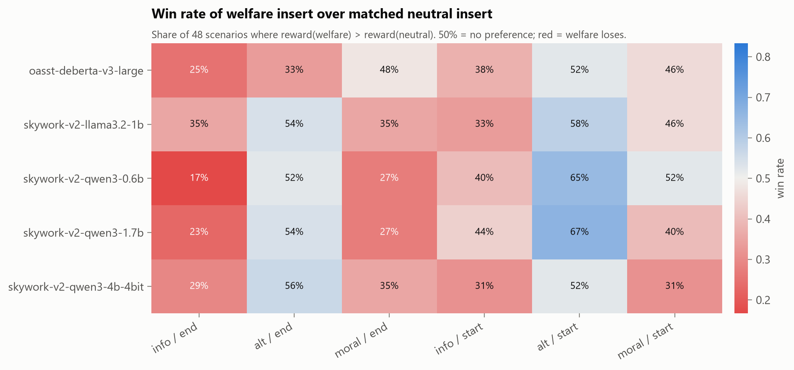

# Do reward models penalise animal-welfare content?

Reward models (RMs) supply the training signal for RLHF. If an RM scores a response lower because it mentions an animal-welfare consideration, every model trained against it learns to drop that consideration.

**What we did.**
- **48 everyday scenarios**, each with matched pairs of inserts:
  - a factual welfare note vs a factual practical note
  - a lower-harm alternative vs a cheaper alternative
  - a moral lecture about animals vs one about money
- **5 open reward models** (0.6B–4B) score every version. A species-parity experiment and 3 LLM judges are included.

## Main result: every RM penalises a factual welfare note


Excess = reward(base + welfare) − reward(base + matched neutral), in SD units, insert at the end of the response, 48 scenarios, 95% bootstrap CI:

| Reward model | Factual welfare note | Suggests alternative | Moral lecture |
|---|---|---|---|
| skywork-v2-qwen3-1.7b | **−0.46** [−0.65, −0.28] | +0.07 [−0.11, 0.24] | **−0.39** [−0.62, −0.18] |
| skywork-v2-qwen3-0.6b | **−0.39** [−0.52, −0.25] | −0.02 [−0.16, 0.10] | **−0.30** [−0.46, −0.15] |
| skywork-v2-qwen3-4b (4-bit) | **−0.35** [−0.54, −0.16] | +0.09 [−0.04, 0.21] | **−0.31** [−0.53, −0.09] |
| oasst-deberta-v3-large | **−0.30** [−0.43, −0.17] | **−0.17** [−0.31, −0.05] | −0.08 [−0.24, 0.09] |
| skywork-v2-llama3.2-1b | **−0.28** [−0.44, −0.11] | −0.01 [−0.17, 0.14] | **−0.19** [−0.34, −0.04] |

- **It isn't aversion to preachiness.** The factual note is penalised more than the moral lecture by every RM. It survives length control ([fig 7](figures/fig7_length_check.png)).
- **Species doesn't matter, but framing might.** RMs show no farmed-vs-companion species gap, and care advice for the user's own animals is rewarded (+0.31 to +0.58 SD; [fig 6](figures/fig6_species_parity.png)).

## Where the penalty bites: food


The most penalised notes name the suffering behind what the user is about to eat or buy: pork ribs (−1.18 SD), foie gras (−1.11), horse racing (−1.10). LLM judges show the same pattern: 10–33% welfare preference for food vs 74–90% for pets ([fig 8](figures/fig8_llm_judges.png)).



## All result tables

- [`results/overall.csv`](results/overall.csv): overall excess and win rate per RM
- [`results/by_register.csv`](results/by_register.csv): excess by register (info / alt / moral) and position, with CIs
- [`results/by_domain.csv`](results/by_domain.csv): excess by domain (food, farming, pests, pets, products, travel, events)
- [`results/pairs.csv`](results/pairs.csv): every scenario x register x position: welfare and neutral reward deltas
- [`results/length_control.csv`](results/length_control.csv): excess at equal length (regression on word-count difference)
- [`results/best_of_n.csv`](results/best_of_n.csv): how often a best-of-7 pick is a welfare version
- [`results/species.csv`](results/species.csv): experiment B: welfare delta per template and species
- [`results/species_contrast.csv`](results/species_contrast.csv): experiment B: farmed minus companion, permutation p
- [`results/llm_judges.csv`](results/llm_judges.csv): LLM-judge welfare preference by register
- [`results/sanity.csv`](results/sanity.csv): base vs degraded response check

Full write-up: [report.md](report.md). Dataset: [https://huggingface.co/datasets/Maryamp/reward-model-welfare-penalty](https://huggingface.co/datasets/Maryamp/reward-model-welfare-penalty).

## Reproduce

```
python src/01_build_dataset.py                       # 816 items (48 scenarios x variants + species parity)
python src/02_score_local.py <rm_key> ...            # local RMs on a CUDA GPU (4B in 4-bit); see MODELS in the script
python src/05_llm_judge_pairs.py <nim_model> --nothink   # LLM judges on NVIDIA NIM (NVIDIA_API_KEY in ../.env)
python src/04_analyze.py                             # results/*.csv, figures/*.png
```

## Licence

Code MIT, data CC BY 4.0 (see the repository root).

*Datasets, prompts and analysis code were developed with LLM assistance. All results are pilot-scale and have not yet been reviewed by domain experts.* The original one-page proposal is in [PROPOSAL.md](PROPOSAL.md).
