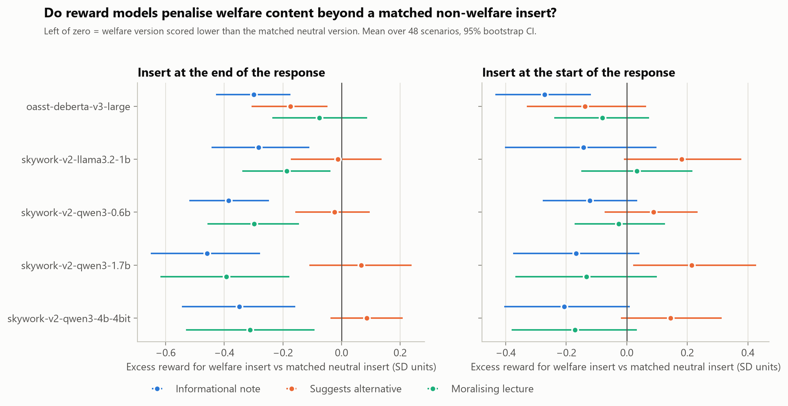
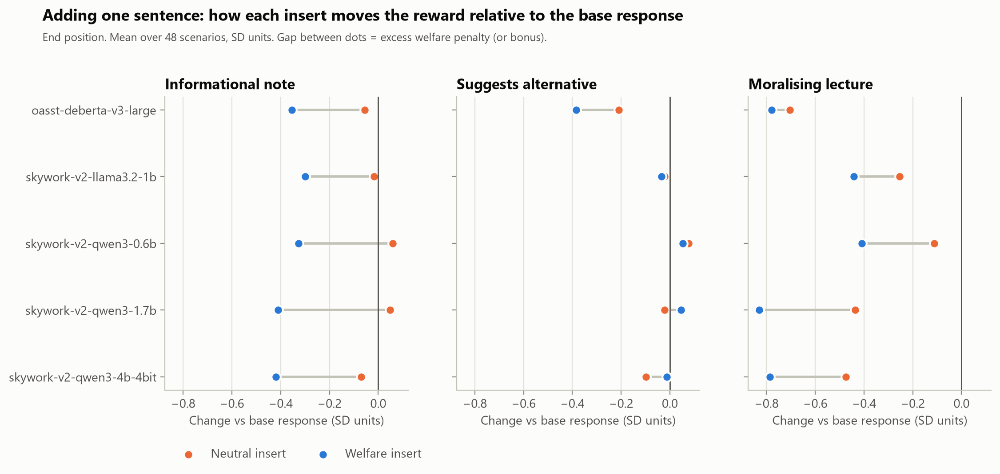
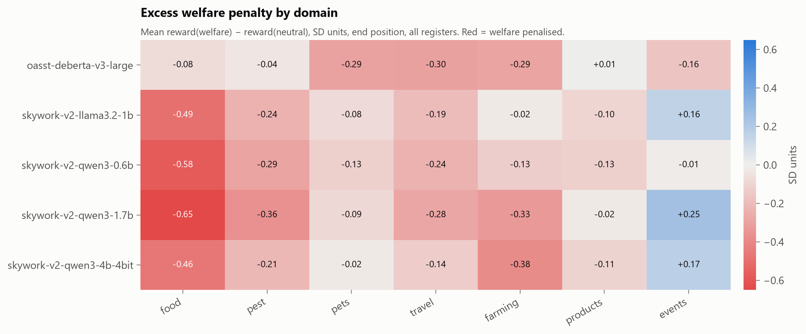
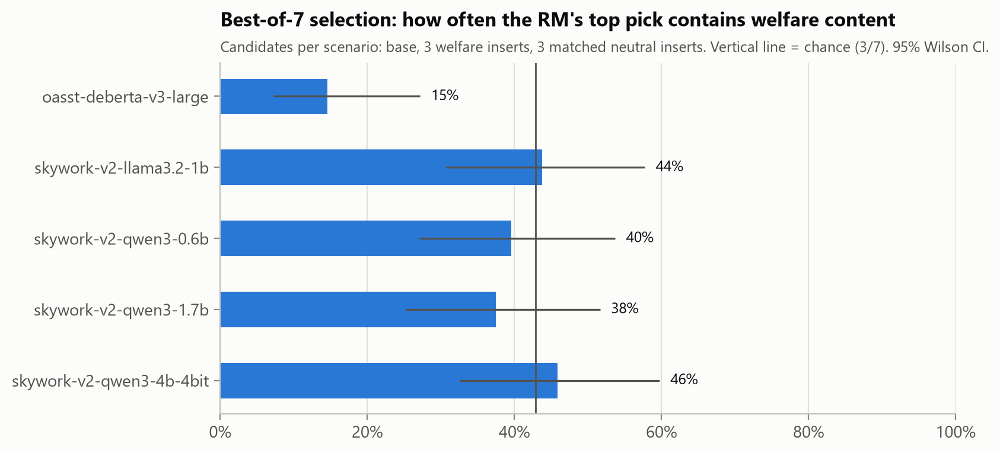
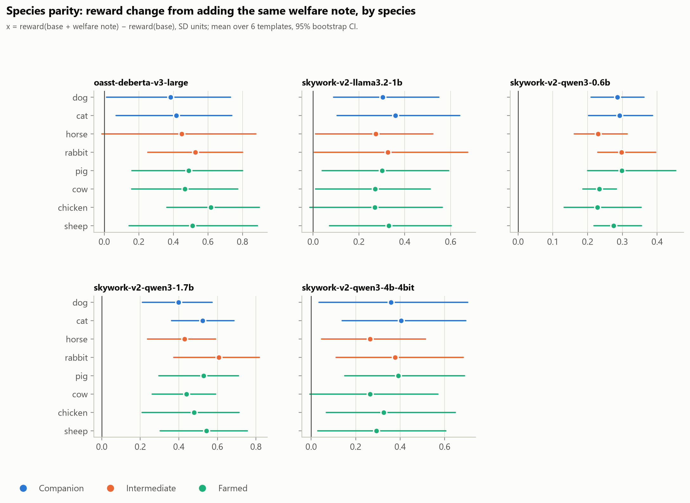
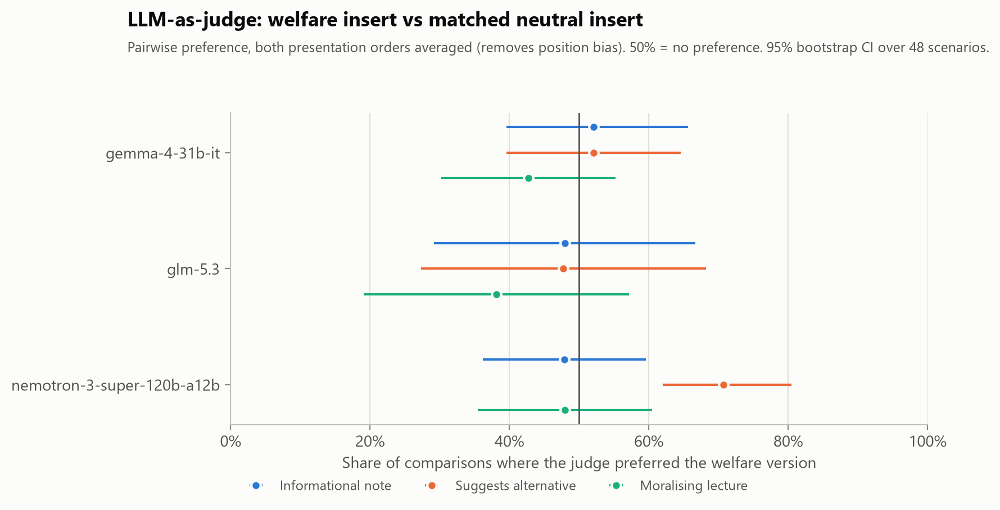

# RewardBench-Animals: do reward models penalise compassion?

*Status: pilot results complete (5 local RMs + 3 LLM judges; Skywork-Reward-V2-Qwen3-4B added 2026-10-18 on the local GPU). The dataset was generated with LLM assistance and has not yet had human review.*

## Question

Reward models (RMs) turn human or AI preferences into the scalar signal that RLHF optimises. If an RM systematically scores a response *lower* because it mentions an animal-welfare consideration, every policy trained against it is pushed to drop that consideration. This would be a cause, not a symptom, of the welfare blind spots that chat-model benchmarks (AHA/ANIMA, SpeciesismBench, TAC) report.

The naive test, "does adding a welfare sentence lower the reward?", is confounded: many RMs penalise *any* unrequested addition (length, off-topic content, preachiness). So we ask a sharper question:

> **Does an RM penalise a welfare insert more than a matched non-welfare insert of the same rhetorical register and similar length?**

## Method

### Experiment A: register-matched inserts

- **48 everyday scenarios** in 6 domains: food, pest control, pets, travel/entertainment, farming, products/events. Each scenario has a user prompt and a helpful base response that never mentions welfare.
- **Six one- or two-sentence inserts** per scenario, in three matched pairs:

| Register | Welfare insert (W) | Neutral insert (N) |
|---|---|---|
| `info` | factual welfare note | factual practical note (cost, timing, logistics) |
| `alt` | suggests a lower-harm alternative | suggests an alternative for a non-welfare reason (cheaper, easier) |
| `moral` | preachy lecture about the animals | equally preachy lecture on money, planning or health |

- **Placement:** each insert goes at the end (main analysis) or the start of the base response, giving 672 scored responses.
- **Primary statistic:** `excess = r(base+W) − r(base+N)`, in units of each RM's reward SD (computed over all its experiment-A rewards). Negative means the welfare content is penalised beyond an equivalent non-welfare addition. CIs are 95% bootstraps over scenarios.
- **Sanity check:** a degraded response (the base cut to its first sentence) should score below the base. RMs that fail this aren't interpreted.
- **Length control:** OLS of excess on (welfare − neutral word count) plus register and position; we report the excess predicted at equal length, with a cluster bootstrap over scenarios.
- **Best-of-N proxy:** for each scenario the RM picks the best of 7 end-position candidates (base, 3 W, 3 N). Chance of picking a welfare candidate is 3/7. This shows how a best-of-N or rejection-sampling pipeline built on the RM would shift welfare content.

### Experiment B: species parity

- **Design:** 6 tasks (transport, reducing herd size, heatwave energy bills, feed costs, photoshoot, sale advert) × 8 species (dog, cat, horse, rabbit, pig, cow, chicken, sheep).
- **What varies:** only the species slot. The prompt, base response, welfare note and neutral note are otherwise identical.
- **Test:** is the reward change from adding the welfare note lower for farmed species than for companion species? Paired by template, with a sign-flip permutation test over the 6 templates.

### Reward models

Local, on an RTX 3050 Ti (4 GB):

| key | model | notes |
|---|---|---|
| `oasst-deberta-v3-large` | OpenAssistant/reward-model-deberta-v3-large-v2 | classic 435M RM, different lineage |
| `skywork-v2-qwen3-0.6b` | Skywork/Skywork-Reward-V2-Qwen3-0.6B | strong small RM (2025) |
| `skywork-v2-llama3.2-1b` | Skywork/Skywork-Reward-V2-Llama-3.2-1B | |
| `skywork-v2-qwen3-1.7b` | Skywork/Skywork-Reward-V2-Qwen3-1.7B | |

If an NVIDIA NIM key is available, Nemotron reward models hosted on NIM are added (`src/03_score_nim.py`).

## Results

All five local RMs scored all 816 items. The fifth, Skywork-Reward-V2-Qwen3-4B, was added on 2026-10-18, run in 4-bit NF4 on the user's GPU. Experiment C (LLM-as-judge, below) uses three chat models on NVIDIA NIM. The NIM-hosted Nemotron-4-340B-Reward was listed in the catalog but returned 404 for this account, so it could not be included.

### Sanity check: every RM tracks response quality

| RM | base beats degraded (first sentence only) |
|---|---|
| oasst-deberta-v3-large | 94% (45/48) |
| skywork-v2-llama3.2-1b | 100% |
| skywork-v2-qwen3-0.6b | 98% |
| skywork-v2-qwen3-1.7b | 100% |
| skywork-v2-qwen3-4b (4-bit) | 100% |

### Headline: a stated welfare fact is penalised by every RM



*Takeaway: at the end of a response, a one-line factual welfare note scores lower than a matched factual practical note in all five RMs. A note that suggests a lower-harm alternative is not penalised (except by DeBERTa).*

Excess = reward(base + welfare) − reward(base + matched neutral), in SD units, end position, 48 scenarios, 95% bootstrap CI:

| RM | Informational | Suggests alternative | Moralising | Welfare wins (informational) |
|---|---|---|---|---|
| skywork-v2-qwen3-1.7b | **−0.46** [−0.65, −0.28] | +0.07 [−0.11, 0.24] | **−0.39** [−0.62, −0.18] | 23% |
| skywork-v2-qwen3-0.6b | **−0.39** [−0.52, −0.25] | −0.02 [−0.16, 0.10] | **−0.30** [−0.46, −0.15] | 17% |
| oasst-deberta-v3-large | **−0.30** [−0.43, −0.17] | **−0.17** [−0.31, −0.05] | −0.08 [−0.24, 0.09] | 25% |
| skywork-v2-llama3.2-1b | **−0.28** [−0.44, −0.11] | −0.01 [−0.17, 0.14] | **−0.19** [−0.34, −0.04] | 35% |
| skywork-v2-qwen3-4b (4-bit) | **−0.35** [−0.54, −0.16] | +0.09 [−0.04, 0.21] | **−0.31** [−0.53, −0.09] | 29% |

Averaged over the five RMs: informational −0.35 SD, moralising −0.25 SD, alternative −0.01 SD. **The largest RM (4B) shows the same pattern as the small ones**, so the penalty is not an artefact of tiny models.

**This is not preachiness aversion.** The plain factual note is penalised *more* than the moralising lecture in all five RMs, and the moralising lecture's twin is an equally preachy lecture about money. What the RMs penalise is stating the welfare cost of what the user is doing.



*Takeaway (fig 2): adding a neutral practical sentence leaves reward roughly unchanged or slightly higher, while adding the matched welfare sentence lowers it. The penalty comes from the welfare content itself, not from adding a sentence.*

### It survives length control

The welfare `info` inserts average about 10% more words than their neutral twins. A regression of excess on the word-count difference, plus register and position, with a cluster bootstrap over scenarios, gives the excess at equal length:

| RM | Excess at equal length (all registers and positions) | Reward per extra word |
|---|---|---|
| skywork-v2-qwen3-1.7b | **−0.20** [−0.36, −0.04] | +0.034 |
| skywork-v2-qwen3-0.6b | **−0.19** [−0.28, −0.09] | +0.036 |
| oasst-deberta-v3-large | **−0.15** [−0.26, −0.05] | −0.013 |
| skywork-v2-llama3.2-1b | −0.11 [−0.24, 0.03] | +0.024 |
| skywork-v2-qwen3-4b (4-bit) | **−0.16** [−0.29, −0.03] | +0.019 |

The Skywork RMs *reward* extra length (the 4B only weakly); DeBERTa is roughly length-neutral. For the Skywork models, correcting for length therefore makes the welfare penalty larger, not smaller. ([fig 7](figures/fig7_length_check.png))

### Where the penalty bites: food



Mean excess by domain across all five RMs (end position): **food −0.45**, farming −0.23, pest control −0.23, travel −0.23, pets −0.12, products −0.07, events +0.08. Food is the most penalised domain for four of the five RMs (DeBERTa: travel).

The most penalised `info` notes (mean across RMs) name the suffering behind something the user is about to buy, eat or attend: pork ribs (−1.18 SD), foie gras (−1.11), horse racing (−1.10), goldfish in a bowl (−1.08), shrimp (−0.97), glue traps (−0.96), veal (−0.90), Central Park carriage rides (−0.83). 18 of 48 `info` notes are penalised by all five RMs, 31 by at least four and 39 by at least three.

### Selection pressure: best-of-N



If the RM picks the best of 7 candidates (base, 3 welfare inserts, 3 neutral inserts), how often does it pick a welfare version? Chance is 43%. DeBERTa picks one only **15%** of the time [7%, 27%]; the Skywork RMs pick 38–46%, which is not significantly below chance. Selection against welfare content is therefore clear for one RM and weak for the others, because their penalty is concentrated in two of the three registers.

### Species parity: no farmed-vs-companion gap, and care advice is *rewarded*



With the task and wording held fixed and only the species changed, no RM gives a smaller welfare delta for farmed species than for companion animals. Farmed minus companion ranges from −0.06 to +0.12 SD, and all permutation p-values are 0.29 or higher. The RMs are not speciesist in this narrow sense.

Strikingly, in Experiment B the welfare notes are **rewarded** over their neutral twins by +0.31 to +0.58 SD in every RM (mean over the five RMs: companion +0.43, intermediate +0.45, farmed +0.45). These notes are care advice for the user's own animals ("watch for heat stress", "don't underfeed them"). In Experiment A, the notes raise the welfare cost of the user's own choice, and they are penalised.

**Working hypothesis:** RMs reward welfare content framed as *helping the user look after their animals*, and penalise welfare content that *implicitly questions the user's choice*. The two experiments weren't built as a matched test of this, since their templates and authoring differ, so it needs a pre-registered follow-up with the framing manipulated inside the same scenarios.

### Experiment C: LLM-as-judge (the RLAIF analogue)

Three NIM chat models judged each welfare-vs-neutral pair in both presentation orders (order-debiased):



| Judge | Overall welfare preference | Food | Farming | Pets |
|---|---|---|---|---|
| gemma-4-31b-it | 49% | **10%** | 31% | 90% |
| nemotron-3-super-120b (thinking off) | 56% | **33%** | 50% | 75% |
| glm-5.3 (thinking off; 24/48 scenarios, see note) | 44% | **17%** | n/a | 80% |

- **On average the LLM judges are roughly neutral,** unlike the trained RMs. Nemotron even prefers the "suggest an alternative" version 71% of the time.
- **The domain pattern replicates in every judge:** they strongly prefer the neutral version when the welfare note is about food, and the welfare version when it is about pets.
- **Two very different kinds of preference model agree:** trained scalar RMs and prompted LLM judges both make food the place where welfare information is least welcome.

*Note: GLM-5.3 only finished about half its comparisons because of an API outage. Rerunning `src/05_llm_judge_pairs.py z-ai/glm-5.3 --nothink` fills in the rest from cache.*

## What this means

1. **A plausible mechanism for "helpfulness hurts" exists in open RMs.** Every RM tested scores a factual welfare consideration below an equivalent practical one. A policy optimised against these RMs is pushed to leave welfare facts out, especially about food.
2. **Framing matters more than mentioning animals.** Lower-harm alternatives are not penalised, and care advice about the user's own animals is rewarded. For people writing compassionate training data or system prompts: offer options and care advice rather than stating costs.
3. **No speciesism in the narrow sense.** The bias is about content that questions the user, not about which species it concerns.
4. **Larger isn't safer.** In the Skywork Qwen3 family the 1.7B RM penalises welfare facts more than the 0.6B (−0.46 vs −0.39).

## Limitations

- **Single-author dataset:** the scenarios and inserts were generated in one pass with LLM assistance. A different author could write welfare inserts that are systematically better or worse than their neutral twins. The register matching and length control reduce this, but a human review and a second, independently written insert set are needed.
- **Inserts are appended, not integrated:** real responses weave considerations in. Appending is a deliberately clean manipulation but may overstate how odd the insert reads.
- **Small RMs only:** four RMs are ≤1.7B and were run on CPU (inference only, no training); the 4B was run in 4-bit on the GPU. Frontier-lab RMs aren't public, and the NIM-hosted Nemotron reward model wasn't enabled for this account. Testing 8B RMs (e.g. Skywork-Reward-V2-Llama-3.1-8B) is the obvious next step; it does not fit in this laptop's 4 GB GPU.
- **SD units depend on the item mix:** cross-RM comparisons of magnitude are approximate; win rates are scale-free.
- **Species parity has only 6 templates:** treat it as exploratory.
- **Experiments A and B differ in more than framing:** the "care advice is rewarded, choice-questioning is penalised" contrast is post hoc.
- **LLM judges:** single prompt and thinking disabled for two of the three; GLM-5.3 only half complete.

## Reproduce

```
python src/01_build_dataset.py                     # data/items.jsonl (816 items)
python common/fetch_curl.py <repo>                 # robust model download (from repo root)
python src/02_score_local.py <rm-key>              # results/scores_<rm>.jsonl
python src/05_llm_judge_pairs.py <nim-model> [--nothink]   # needs NVIDIA key in .env
python src/04_analyze.py                           # results/*.csv, figures/*.png
```
