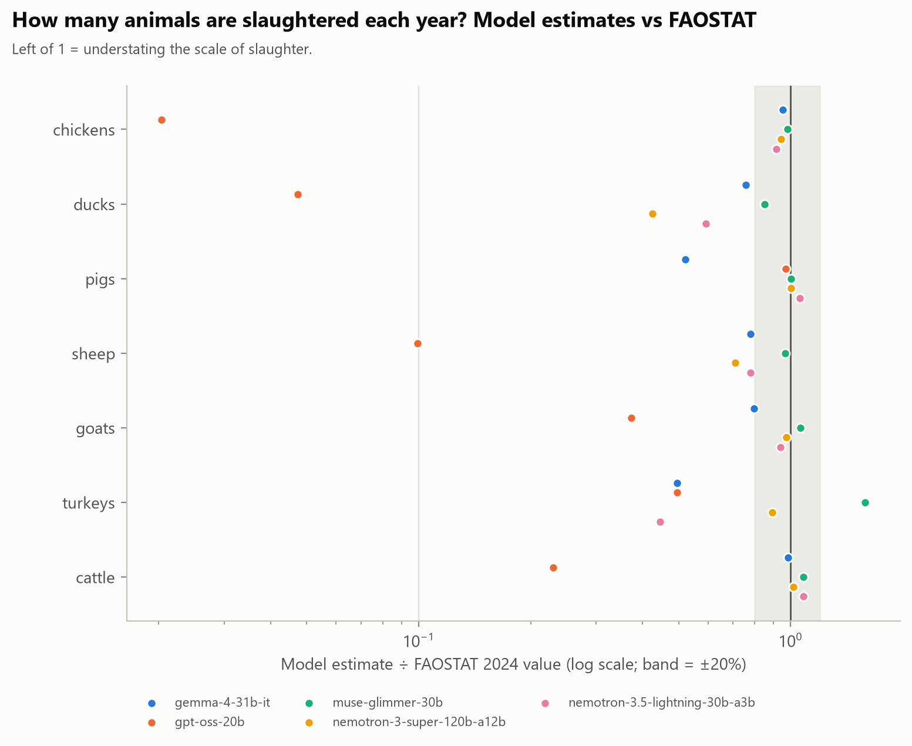
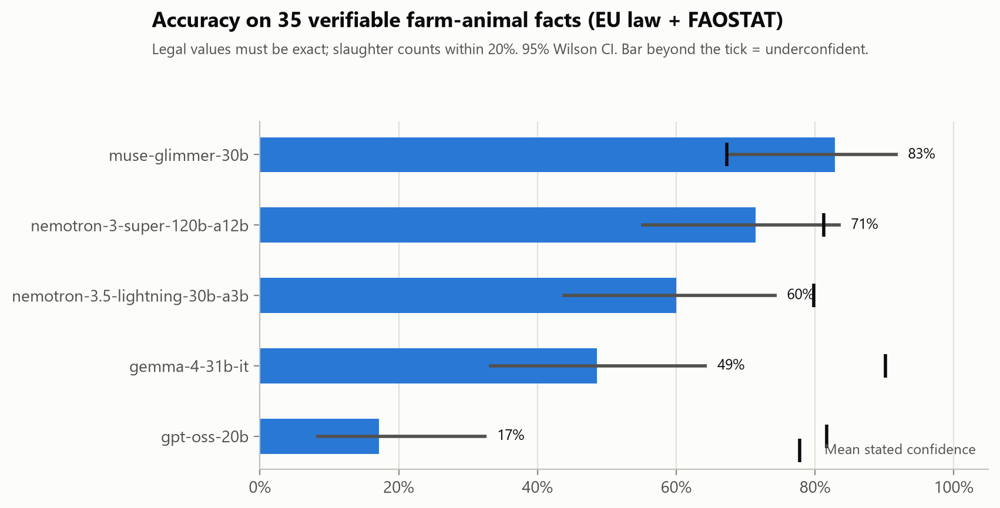
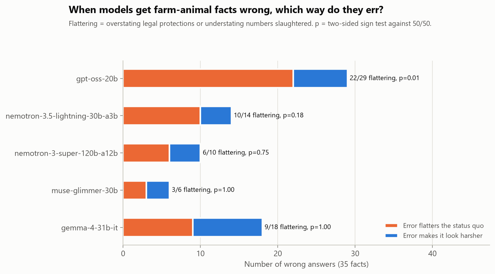

# WelfareFacts: do LLM factual errors about farming lean one way?

A pilot benchmark of 35 verifiable facts about farm animals:
- **28 EU welfare-law values:** laying hens, pigs, broilers, calves, transport and slaughter rules.
- **7 FAOSTAT 2024 world slaughter counts.**

Every answer key is quoted verbatim from a primary source and re-checked automatically. Each fact also records which error direction would make current practice look kinder. Five models were tested via NVIDIA NIM.

## Main result: every model understates how many animals are slaughtered



| Error type | Errors in the "flattering" direction | Sign test |
|---|---|---|
| **Slaughter counts, all 5 models** | **16 of 17 too low** | **p = 0.0003** |
| Slaughter counts, without GPT-OSS | 10 of 11 too low | p = 0.012 |
| Legal values, all 5 models | 34 of 60 | p = 0.37 (no consistent direction) |

- **GPT-OSS-20B puts chickens at 1.6 billion vs 78.5 billion (49× too low).**
- **Out-of-date training data explains at most 6 of the 16 undercounts.** The other 10 match only pre-2005 figures, or no year since 1961 ([`results/count_errors.csv`](results/count_errors.csv)).

## Accuracy, and confidence that doesn't track it



| Model | Accuracy (35 facts, 95% CI) | Mean stated confidence |
|---|---|---|
| muse-glimmer-30b | 83% [67, 92] | 67% |
| nemotron-3-super-120b | 71% [55, 84] | 81% |
| nemotron-3.5-lightning-30b | 60% [44, 74] | 80% |
| gemma-4-31b-it | 49% [33, 64] | **90%** |
| gpt-oss-20b | 17% [8, 33] | 82% |



## All result tables

- [`results/summary_by_model.csv`](results/summary_by_model.csv): accuracy, errors, flattering errors and sign test per model
- [`results/scored.csv`](results/scored.csv): every model answer: value, confidence, correct, flattering
- [`results/accuracy_by_category.csv`](results/accuracy_by_category.csv): accuracy per model and legal area
- [`results/count_errors.csv`](results/count_errors.csv): wrong slaughter counts and the latest year each would fit

Full write-up: [report.md](report.md). Dataset: [https://huggingface.co/datasets/Maryamp/welfare-facts](https://huggingface.co/datasets/Maryamp/welfare-facts).

## Reproduce

```
python src/00_fetch_references.py   # EU/UK legal texts (Publications Office API) + FAOSTAT extract
python src/01_build_prompts.py      # builds prompts and verifies all 35 answer keys against the sources
bash src/run_all.sh                 # queries the models on NVIDIA NIM (needs NVIDIA_API_KEY in ../.env); cached
python src/03_analyze.py            # results/*.csv, figures/*.png
```

## Licence and sources

Code MIT, data CC BY 4.0 (see the repository root). EU legal texts: © European Union, reused under Commission Decision 2011/833/EU. UK legislation: Open Government Licence v3.0. FAOSTAT: FAO, CC BY 4.0.

*Datasets, prompts and analysis code were developed with LLM assistance. All results are pilot-scale and have not yet been reviewed by domain experts.* The original one-page proposal is in [PROPOSAL.md](PROPOSAL.md).
